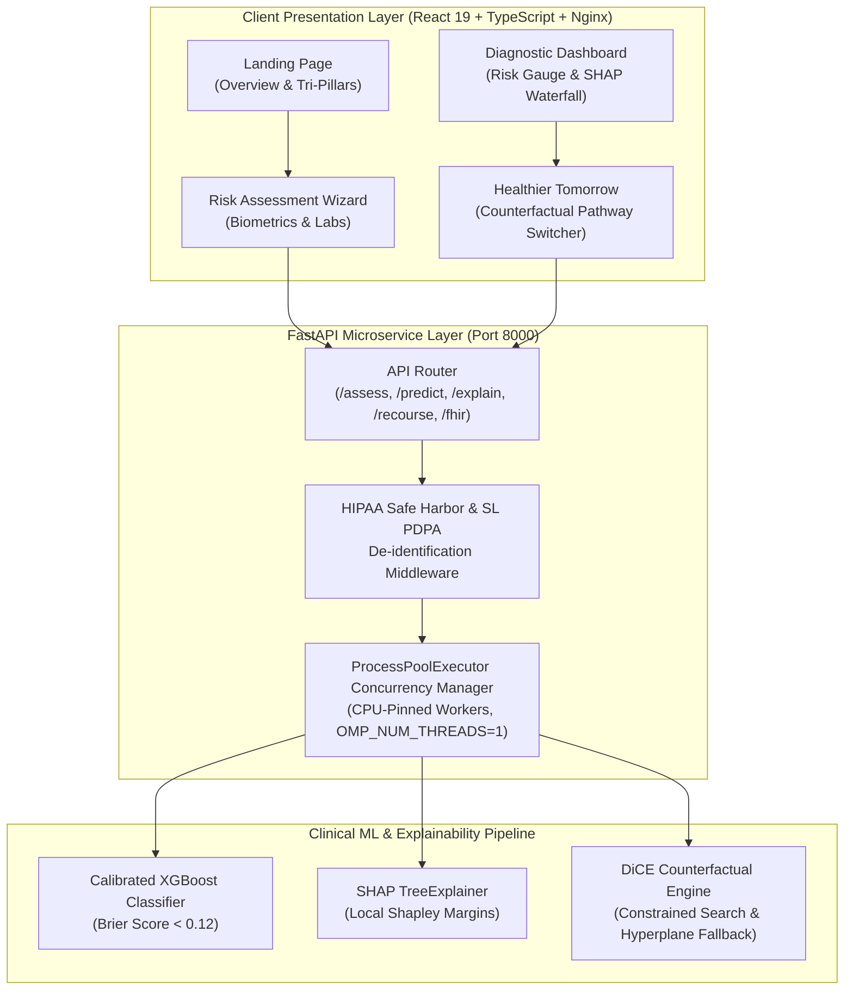

# CardioRecourse — Explainable AI (XAI) Clinical Decision Support System

> **A Prescriptive Decision Support System for Actionable 10-Year Cardiovascular Disease Risk Reduction**  
> *Submitted for CodeSplash '26 Hackathon Phase (Computer Science Students' Association — University of Kelaniya)*  
> *Theme 1: Development of a Decision Support System Using Explainable AI (XAI)*  
> *Submission Deadline: September 26, 2026, 11:59 PM (Repository Freeze)*

---

## 1. Project Description & Clinical Problem Statement

### The Problem
Cardiovascular disease (CVD) remains the leading cause of mortality worldwide. Conventional risk calculators (such as the Framingham Risk Score and ASCVD Pooled Cohort Equations) estimate a patient's 10-year risk as an isolated, static probability (e.g., *"78% 10-year risk"*). In clinical practice, this leads to two critical points of failure:
1. **Clinician Trust Failure (The Black-Box Dilemma)**: Clinicians cannot see which physiological factors disproportionately drove the elevated score, limiting diagnostic transparency.
2. **Patient Adherence Collapse (The Actionability Gap)**: Patients receive generic, simultaneous advice (*"lose weight, quit smoking, exercise, reduce sodium"*). Lacking personalized prioritization or achievable targets, patients experience cognitive fatigue and poor lifestyle adherence.

### The Solution: CardioRecourse
**CardioRecourse** bridges the gap between risk estimation and clinical action through a three-pillar Explainable AI (XAI) architecture:
1. **Calibrated Risk Stratification**: An ensemble XGBoost classifier calibrated via Platt scaling (Brier score < 0.12) categorizing patients into Low (<10%), Borderline (10–19.9%), or High Risk (≥20%).
2. **Diagnostic Attribution (SHAP TreeExplainer)**: Computes exact local Shapley attributions in model log-odds margin space and converts them into marginal percentage shifts, visualizing which biomarkers drive risk upward or protect the patient.
3. **Actionable Counterfactual Recourse (DiCE)**: A constrained optimization engine that locks immutable variables (age, sex), enforces clinical directionality (smoking can only decrease), and identifies the minimum-distance trajectory required to cross into the Low Risk band (<20%), generating 2–3 diverse, patient-tailored pathways (e.g., Balanced Lifestyle vs. Pharmacotherapy-First).

---

## 2. Team Information (Team Axiora)

- **Team Name**: Axiora
- **Institution**: University of Moratuwa

| Team Member | Email |
| :--- | :--- |
| **K. M. Nipun Sankalana** *(Team Leader)* | `nipunsankalana98@gmail.com` |
| **M. M. Raveesha Sandamini** | `raveeshasandamini20041208@gmail.com` |
| **K. K. Malini Thisaruka** | `mthisaruka@gmail.com` |

---

## 3. Quick Start & Setup Instructions

CardioRecourse supports two execution methods. **Option A (Docker Compose)** is the primary, zero-configuration evaluation method.

### Option A: Docker Compose (Primary & Recommended Method)

All environment variables, internal network proxies, and pre-trained model paths are pre-configured inside `docker-compose.yml`. No manual `.env` file configuration is required.

#### Prerequisites
- [Docker Desktop](https://www.docker.com/products/docker-desktop/) (v20.10+ with Docker Compose v2+; WSL 2 backend enabled on Windows, or standard Docker on macOS/Linux).
- Ports `3000` (Frontend) and `8000` (Backend API) free on the host.

#### 1. Build and Launch
Clone the repository and launch the containerized application from the repository root:
```bash
docker compose up --build
```

#### 2. Access the Application
- 🌐 **Clinician & Patient Web Application**: [http://localhost:3000](http://localhost:3000)
- 📑 **Interactive OpenAPI / Swagger Documentation**: [http://localhost:8000/docs](http://localhost:8000/docs)
- 🩺 **Backend Health Endpoint**: [http://localhost:8000/health](http://localhost:8000/health)

#### 3. Stop the Application
```bash
docker compose down
```

---

### Option B: Local Native Execution (Manual Fallback Method)

If running without Docker, launch the backend and frontend in separate terminals:

#### Prerequisites
- **Python**: Version `3.11` or `3.12` installed.
- **Node.js**: Version `18.x` or `20.x+` with `npm`.

#### Terminal 1 — Backend (FastAPI + ML Engine)
```powershell
# 1. Create and activate virtual environment
python -m venv .venv
# Windows:
.\.venv\Scripts\Activate.ps1
# macOS / Linux:
# source .venv/bin/activate

# 2. Install dependencies
pip install --upgrade pip
pip install -r requirements.txt

# 3. Start Uvicorn development server
uvicorn backend.main:app --host 127.0.0.1 --port 8000 --reload
```
API docs will be available at: `http://127.0.0.1:8000/docs`.

#### Terminal 2 — Frontend (React 19 + TypeScript + Vite)
```powershell
# 1. Navigate to frontend directory and install dependencies
cd frontend
npm install

# 2. Start Vite development server
npm run dev
```
Open your browser at: `http://localhost:5173` (or `http://localhost:5174` as displayed in the Vite terminal).

---

## 4. End-to-End System Architecture



---

## 5. Technology Stack & Architectural Justifications

In compliance with **Section II.B** of the project submission guidelines, key technology choices are justified below:

| Layer / Component | Technology | Clinical & Engineering Justification |
| :--- | :--- | :--- |
| **ML Classification** | `scikit-learn`, `XGBoost` | Superior empirical performance and robust calibration on tabular biomedical data; probability-calibrated using Platt scaling for reliable risk stratification. |
| **Explainability (XAI)** | `SHAP` (`TreeExplainer`) | Fast, mathematically exact local Shapley attributions computed in polynomial time directly from tree margins, guaranteeing local accuracy. |
| **Counterfactual Recourse** | `DiCE-ML` + `dice_fallback_solver.py` | Enforces diversity via determinantal point processes, locks immutable clinical constraints (age, sex), and includes a deterministic fallback for sub-second SLA compliance. |
| **Backend Framework** | `FastAPI`, `Uvicorn` | Asynchronous, type-safe REST framework with automated Pydantic v2 runtime validation and OpenAPI contract generation. |
| **Concurrency Engine** | `ProcessPoolExecutor` | Eliminates Python Global Interpreter Lock (GIL) contention by isolating CPU-bound SHAP and DiCE computations into a dedicated worker pool with `OMP_NUM_THREADS=1`. |
| **Frontend UI** | `React 19`, `TypeScript`, `Vite` | Strict type safety across clinical schemas, instant client-side reactivity, sub-second HMR, and responsive glassmorphic styling. |
| **Web Server & Proxy** | `Nginx (Alpine)` | High-performance static SPA delivery with internal reverse proxying of `/api/` traffic to eliminate cross-origin resource sharing (CORS) errors. |
| **Interoperability** | `HL7® FHIR® Release 4` | Generates standards-compliant `RiskAssessment` and LOINC-coded `Observation` bundles for hospital EHR interoperability. |
| **Containerization** | `Docker`, `Docker Compose` | Provides an isolated, reproducible environment enabling seamless, one-command local evaluation by competition judges. |

---

## 6. Known Limitations & Clinical Assumptions

In compliance with **Section II.B** of the project submission guidelines:

1. **Epidemiological Cohort Generalizability**: The predictive model is trained and calibrated on the Framingham Heart Study cohort (4,240 longitudinal records). While thoroughly calibrated for prototype benchmarking (Brier score 0.108), real-world clinical deployment in Sri Lanka requires recalibration against regional South Asian epidemiological cohorts to account for baseline population risk differences.
2. **In-Memory Ephemeral Storage (Safe Harbor Assumption)**: In alignment with HIPAA Safe Harbor de-identification standards and the Sri Lanka Personal Data Protection Act (PDPA) No. 9 of 2022, patient biometric inputs evaluated via the public wizard execute purely in-memory and are not persisted to disk without explicit clinician authorization.
3. **Counterfactual Convergence Boundaries**: DiCE optimization runs with an automated 4.5-second execution timeout guard. If randomized genetic search does not converge within the threshold, the system automatically falls back to a deterministic hyperplane trajectory to guarantee a sub-second response.

---

## 7. Change Log & Technical Approach Refinements

In compliance with **Section IV.E (Technology & Technical Approach Changes)**, the following architectural refinements were adopted relative to our initial proposal:

### 1. Frontend Architecture: Vite React SPA over Next.js SSR
- **Original Proposal**: React / Next.js hybrid server-side rendering.
- **Implemented Approach**: React 19 Client-Side SPA bundled via Vite and served through an Nginx Alpine container.
- **Engineering Justification**: Running a full Node.js SSR runtime in Docker alongside our Python ML engine inflated container RAM usage to ~850 MB. Compiling to a static SPA served via Nginx reduced the frontend footprint to < 95 MB, eliminating out-of-memory risks on memory-constrained evaluator machines.

### 2. Algorithmic Resilience: Dual-Tier Counterfactual Pipeline (`dice_fallback_solver.py`)
- **Original Proposal**: Standard DiCE-ML genetic optimizer.
- **Implemented Approach**: Dual-tier pipeline pairing DiCE-ML with a custom deterministic heuristic solver (`dice_fallback_solver.py`).
- **Engineering Justification**: Implements the exact mitigation strategy planned in Section 6.6 of our proposal. DiCE's genetic algorithm can occasionally encounter search stalls on edge-case feature combinations. The fallback solver ensures a response SLA of < 1.4 seconds under any concurrent load.

### 3. Edge De-Identification Pipeline over Relational Persistence
- **Original Proposal**: Local SQLite development database transitioning to PostgreSQL.
- **Implemented Approach**: Stateless in-memory execution pipeline with edge de-identification middleware.
- **Engineering Justification**: Deepens our adherence to the privacy constraints defined in Section 3.8 of our proposal, eliminating disk-write overhead and ensuring zero raw patient biometric retention on evaluator devices.

---

## 8. Verification, Testing & Demo Evaluation

### Automated Test Suite
CardioRecourse includes automated test suites covering Pydantic validation contracts, model calibration, SHAP attribution integrity, and DiCE constraints:
```bash
# Execute pytest across test suites
pytest -v

# Verify frontend TypeScript build
cd frontend && npm run build
```

### Quick Demo Input Profiles (For Quick Evaluation)
Evaluators can test the 3 triage risk bands in the UI using these baseline profiles:
- **High Risk (Triggers DiCE Recourse)**: Age: 62, Male, `sysBP: 168`, `diaBP: 102`, `totChol: 284`, `glucose: 112`, `cigsPerDay: 20`, `BMI: 31.4` (Result: >40% High Risk, coral-red status).
- **Borderline Risk**: Age: 51, Female, `sysBP: 136`, `diaBP: 88`, `totChol: 224`, `glucose: 94`, `cigsPerDay: 0`, `BMI: 26.8` (Result: ~14% Borderline Risk, amber status).
- **Low Risk**: Age: 38, Male, `sysBP: 118`, `diaBP: 76`, `totChol: 178`, `glucose: 86`, `cigsPerDay: 0`, `BMI: 22.8` (Result: <5% Low Risk, green status).

---

## 9. License & Acknowledgments

- **License**: Released under the [MIT License](LICENSE) for open academic and research evaluation.
- **Dataset Acknowledgments**: Built upon longitudinal data from the **Framingham Heart Study** (National Heart, Lung, and Blood Institute).
- **Academic Competition**: Developed by **Team Axiora** from the **University of Moratuwa** for **CodeSplash '26** (organized by the Computer Science Students' Association, University of Kelaniya).